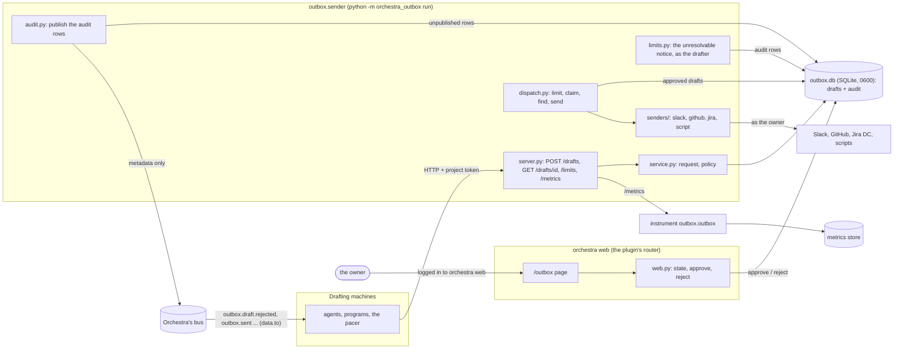
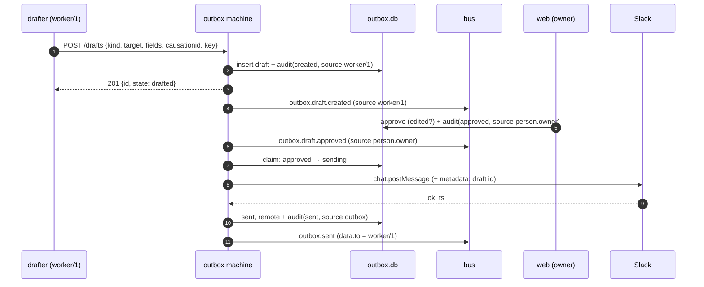

# orchestra-outbox: architecture

How the Outbox is built. `SPEC.md` is the design; this is the map of the code.

## 1. The picture

Two processes write the record: the machine (drafts, policy, sends, publishing) and the web server
(the owner's decisions). Only the machine holds tokens, calls other systems, and publishes.

## 2. Modules

| Module | What |
|---|---|
| `__init__.py` | the names: plugin `outbox`, machine `outbox`, default owner `owner` |
| `config.py` | `[outbox]`: systems, kinds, the owner's person id, checked key by key (`problems`, `settings`) |
| `accounts.py` | the owner's shared accounts directory: tokens, API addresses, account ids; the owner in the identity map (no outbox imports) |
| `actions.py` | the sensitive actions: PR approval refused, merge actions recognised |
| `limits.py` | rate limits: `wait` before a send, `status`, `usage`, and `review` (the unresolvable notice) |
| `check.py` | `orchestra-outbox check`, `example`, `limits`: for people and the Supervisor's tools |
| `kinds.py` | the built-in senders' specs: target, content, default recipient, idempotent |
| `templates.py` | `$name` templates for content and payloads (`string.Template`) |
| `store.py` | the record: drafts, the audit log (also the queue of bus events), conditional moves, counts |
| `service.py` | `Outbox`: a machine's request (validation, template, policy, limit), the owner's approve and reject |
| `dispatch.py` | `Dispatcher`: the limit, claim, `find` before a retry, send, record sent/failed/later, back-off |
| `senders/http.py` | JSON over HTTP, same-origin only, every failure a `SendError` code |
| `senders/slack.py`, `github.py`, `jira.py`, `script.py` | the senders (SPEC §6) |
| `credentials.py` | each system's token, through `accounts.py` (SPEC §9) |
| `audit.py` | the event contract and `flush` |
| `measures.py` | `/metrics` from the record |
| `server.py` | the machine's HTTP API |
| `machine.py` | the process: announce, serve, every 0.5 s reload/flush/dispatch/review/flush |
| `client.py` | `OutboxClient` for Python drafters |
| `plugin.py` | the entry point: page, router, declared machine, process, instrument |
| `web.py` | the page's API (rule 9's human path) |
| `static/` | the page: `outbox.html`, `outbox.js`, `outbox.css` |

## 3. One draft, in order

If step 9's answer is lost, the draft stays `sending`; the next try reads the channel for the
message carrying the draft's id and records it sent without posting again (`dispatch.py`).

## 4. Decisions, and why

- **Drafting by API, not by bus**: the bus carries no text. SPEC §3.
- **The machine's API, not the web server's**: the machine runs where the drafters run, and the
  web server is the owner's, perhaps tunnelled; it should not also be the machines' door.
- **The audit log is the event queue** (a transactional outbox): a decision and its event cannot
  part. The web server never publishes; the machine does, within half a second, with a stable id.
- **Approval writes, the machine sends**: one process holds every write token (story placement
  §2.2: "one place holds every write token and every audit record").
- **The fakes and the API clients are copied, not imported** from `~/orchestra-bridges`: the owner
  decided (2026-10-27) to keep the copies until it is decided what library they belong in; what is
  shared now is the accounts and tokens (`accounts.py`, SPEC §9). The senders' HTTP code is the
  bridges' pattern (same-origin redirects, codes not bodies), written again here.
- **SQLite**: two processes, conditional updates, durable before `201` is answered.
- **Rate limits count sends begun, and pace every draft**, whoever approved it: a draft over the
  limit waits for the window (the owner's decision). The check is in the claim's transaction, so
  two drafts cannot both take the last place.
- **The rate-limit notice is the drafter's**, not the outbox's (Orchestra's D19): the drafter's
  drafting is what outruns the limit. It goes through the audit log like every other event, with
  the resource as its subject.

## 5. Tests

| File | What |
|---|---|
| `tests/fake_http.py` | the fakes' server: token, scripted failures, `lose_next` (act, then drop the answer), `asleep` |
| `tests/fake_slack.py`, `fake_github.py`, `fake_jira.py` | the three APIs, in their shapes |
| `tests/unit/test_flow.py` | draft → approve on the page's API → Slack gets it once; edit; reject tells the drafter; refusals |
| `tests/unit/test_autonomy.py` | `auto` sends and is audited; over the limit it waits for the window, not the owner; per recipient |
| `tests/unit/test_rate_limits.py` | sent later and never over the limit; the unresolvable notice and its resolution; patience; the usage series, `/limits`, the CLI; an API's rate limit |
| `tests/unit/test_sensitive.py` | pings need recipients; PR approval refused (check, draft, edit, send, sender); the first merge per PR; opening a PR |
| `tests/unit/test_accounts.py` | the shared token lookup; API address and owner from accounts.toml or the identity map; approvals carry the person id; the five starting kinds pass `check` |
| `tests/unit/test_idempotent.py` | lost answers (Slack, thread, GitHub), 5xx, restart mid-send, the bus down |
| `tests/unit/test_jira_and_script.py` | Jira comment, transition, create; the script sender's contract |
| `tests/unit/test_canary.py` | no content on the bus, in metrics, logs or any other file |
| `tests/unit/test_config_check.py` | the contract, the check (CLI and JSON), SPEC's example, reload |
| `tests/unit/test_plugin.py` | the declaration, Orchestra loading it, the page, the metrics, file modes |
| `tests/e2e/test_orchestra_run.py` | `orchestra run` loads it; draft, approve, sent once; the instrument stores; a restart sends nothing twice |
