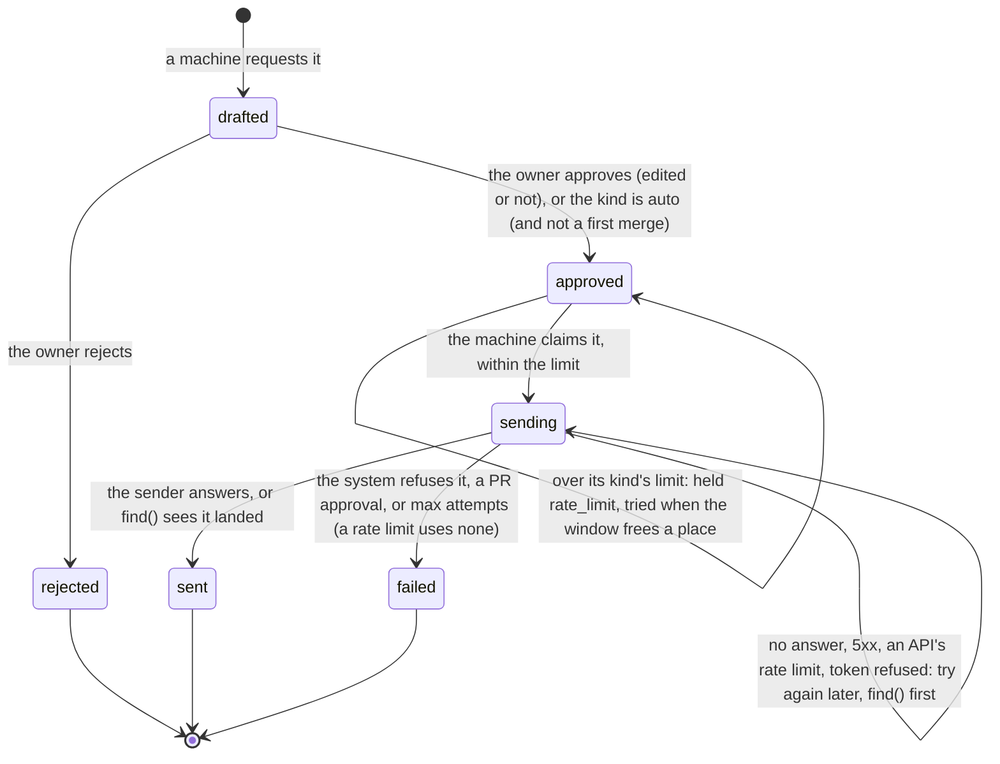

# The Outbox: specification

Status: phase 1 with the owner's decisions of 2026-10-27 (§12). The design. `AGENTS.md` lists the
rules that must not break.

The Outbox is an Orchestra plugin (`orchestra-outbox`, plugin `outbox`). It is the one way
anything is said or done **as the owner** in another system: Slack, GitHub, Jira, or anything a
script can reach. Machines write **drafts**; the owner **approves** (perhaps after editing) or
**rejects** each one on the Outbox page; the outbox machine **sends** what was approved, once; and
every step is an event on the bus, with metadata and never the text.

It is building block 1 of `~/orchestra_2/docs/roadmap/story-placement.md` §5, used by 19 of the 21
user stories.

Contents:

1. [Principles](#1-principles)
2. [The draft](#2-the-draft)
3. [Drafting: the API](#3-drafting-the-api)
4. [Configuration: the contract](#4-configuration-the-contract)
5. [Approval](#5-approval)
6. [Sending](#6-sending)
7. [Events](#7-events)
8. [Measurements](#8-measurements)
9. [Credentials](#9-credentials)
10. [The plugin](#10-the-plugin)
11. [Not in phase 1](#11-not-in-phase-1)
12. [The owner's decisions](#12-the-owners-decisions)

---

## 1. Principles

These are the owner's, from `docs/user-stories.md` ("What stays mine") and the owner's answers of
2026-10-27:

1. **Nothing is said or pushed as the owner without passing through the Outbox and the owner's
   approval.** Every kind waits for approval unless its configuration says `approval = "auto"`.
2. **Autonomy is configured, never built in.** A kind is loosened only by an explicit entry, which
   the owner asks the Supervisor to make. The Outbox measures what the owner would need to decide
   (unedited approvals in a row, the edit rate) but changes no setting itself.
3. **Kinds and their senders are configured, not coded.** A kind is a config entry naming its
   sender, a template and its approval. A workflow too complicated for configuration is a
   **script**, in the target repository or elsewhere, never plugin code.
4. **The Supervisor configures it; it never writes plugin code.** The contract in §4 is exact so
   that its tools can edit it, and `orchestra outbox check` validates an edit before it is made.
5. **The bus carries no text.** Events carry ids, kinds, targets, codes and flags (Orchestra's rule
   3; the bridges' privacy rule). The text lives only in the Outbox's record.
6. **Rule 9.** The Outbox page is a human path that changes the system, which Orchestra allows
   only in a plugin. It is the owner's and nothing else's.
7. **A limit paces; it never drops and never asks.** A draft over a rate limit is sent later, when
   the window allows. When waiting will not clear it, the machines behind it say so on the bus, and
   the owner tells the Supervisor what to do (§5.3).
8. **Some actions are never the Outbox's, and some need the owner once.** No kind approves a pull
   request; the first merge action on each pull request is the owner's (§6.6).

## 2. The draft

| Field | Meaning |
|---|---|
| `id` | `d` + 15 hex digits |
| `kind` | the configured kind's name (`review.request`) |
| `target` | where it goes: depends on the sender (§6) |
| `recipients` | who it reaches, for the limits (§5.3): ids the drafter names, else the sender's default (the channel, `owner/repo#n`, the issue key). A ping kind (`ping = true`) has no default: the drafter must name them |
| `content` | the text to send: the drafter's, rendered by the kind's template, or the owner's edit |
| `original` | the content as drafted, kept when the owner edits |
| `fields` | the drafter's fields, for the template and a payload |
| `drafter` | the machine that drafted it (its source) |
| `causationid`, `correlationid` | why: the event or ticket that caused it |
| `key` | the drafter's idempotency key: the same key again returns the same draft |
| `state` | below |
| `edited` | approved with an edit ("edited and approved") |
| `approved_by` | `owner` or `policy` |
| `approver` | the owner's person id (§4.1), when the owner approved or rejected it |
| `held` | why it waits: `rate_limit` (approved, sent when its kind's window allows, §5.3), `api_rate_limit` (sending, when the API allows), `first_merge` (an `auto` merge action waiting for the owner, §6.6) |
| `held_since` | when it first waited for one of those |
| `reason`, `note` | a rejection's code (on the bus) and the owner's words (never on the bus) |
| `remote` | where it landed (`{channel, ts}`, `{repo, number, comment}`, `{issue}`, `{exit: 0}`) |
| `attempts`, `error`, `output` | sending: tries, the last error's code, a script's output |
| `created_at`, `decided_at`, `sent_at` | times |



`approved`, `rejected`, `sent` and `failed` are what the brief calls approved, rejected, sent and
failed; "edited and approved" is `approved` with `edited: true`.

The record is SQLite at `~/.orchestrator/<key>/outbox/outbox.db` (directory `0700`, file `0600`),
written by two processes (the machine and the web server), each change one transaction,
conditional on the state it leaves.

## 3. Drafting: the API

**Decision: machines draft through the outbox machine's HTTP API, not through the bus.** A draft
is text, and the bus carries no text (§1.5); an event that carried a draft would put the owner's
words in every bus backend, every reader's hands and the model's inputs. The bus still sees every
draft (§7), as metadata. The API is the outbox machine's own (not the web server's): the machine
is what `orchestra run` keeps up beside the drafters, while the web server may not run, and is
the owner's (and may be tunnelled).

`POST http://<[outbox] host:port>/drafts`, with `Authorization: Bearer <the project's token>` (the
token Orchestra gives every process it launches, `ORCHESTRA_EVENTS_TOKEN`; `orchestra events
endpoint` prints it for others):

```json
{
  "drafter": "worker/1",
  "kind": "review.request",
  "target": {"channel": "C0REVIEW"},
  "content": "optional: the text, or $content in the kind's template",
  "fields": {"link": "https://github.com/acme/widgets/pull/7", "reviewers": "@ana @bo"},
  "recipients": ["U0ANA", "U0BO"],      // required for a ping kind; else the target's default
  "causationid": "<the event that caused it>",
  "correlationid": "<the ticket>",
  "key": "rr:acme/widgets#7"
}
```

- `201 {"ok": true, "new": true, "draft": {...}}`; `200` with `"new": false` when the `key` was
  seen from that drafter; `400 {"ok": false, "error": "<why>"}` (an unknown kind, a bad target, a
  field the template needs, a ping without `recipients`, content that would approve a pull request,
  a drafter named `outbox` or the owner); `401` without the token.
- `GET /drafts/<id>`: the draft as it stands, with `content`, `note`, `state`, `remote`, `error`.
- `GET /limits`: the rate limits in use (§5.3), with the token.
- The address: `[outbox] host` and `port` (default `127.0.0.1:9467`), also written to
  `<state>/outbox/endpoint.json` while the machine runs (`port = 0` picks a free port).
- Python: `orchestra_outbox.client.OutboxClient.for_project(project, drafter=...)`.
- A drafter learns what happened by listening for the events of §7 whose `data.to` is its source.

Limits: `fields` at most 50 entries (names `[A-Za-z_][A-Za-z0-9_]*`, values strings up to 20,000
characters or numbers); `recipients` 1 to 50 ids; refs up to 200 characters; a body up to 1 MB.

## 4. Configuration: the contract

All of it is `[outbox]` in the project's `orchestra.toml` or the owner's private overlay
(`orchestra.local.toml` in the state directory, Orchestra's SPEC §8.1), which is where the owner's
channels, templates and kinds belong. Orchestra ignores the section. Tokens, API addresses and the
owner's account ids are in neither: they are the shared accounts directory's (§9). **Unknown keys are refused**, so a typo is an error, not a
silent default. The machine re-reads the section when the file changes; a version that fails the
check is logged and the last good one stands; the web server re-reads it on every request.

### 4.1 `[outbox]`

| Key | Type | Default | Meaning |
|---|---|---|---|
| `owner` | string (a source) | see below | the owner's person id: the source the owner's approvals and rejections publish as, and the `approver` they carry, e.g. `"person.daniel"`. Not `"outbox"` |
| `people` | path | `[bridges] people` | the identity map (the bridges' `people.toml`), relative to the repository |
| `merge_labels` | list of strings | `[]` | labels that merge a pull request (e.g. `["SAIL"]`): adding one is a merge action (§6.6) |
| `host` | string | `"127.0.0.1"` | where the API and `/metrics` listen. Loopback only |
| `port` | integer 0..65535 | `9467` | `0`: any free port, written to `endpoint.json`, and no instrument |

**The owner's person id**, in order: `[outbox] owner`; `owner` in the shared `accounts.toml` (§9);
the identity map's one person entry (`[people.<key>]`, not `bot = true`) that lists one of the
owner's accounts named in `accounts.toml` (`[slack] account`, `[github] account`, ...), as
`person.<key>`, the very source the bridges give that person's own acts, so the owner's approvals
and the owner's Slack replies are one machine; else `"owner"`, which `check` warns about.

### 4.2 Systems: `[outbox.slack]`, `[outbox.github]`, `[outbox.jira]`

A system's connection, needed by its built-in senders. Present = configured.

| Key | Type | Default | Meaning |
|---|---|---|---|
| `api` | URL | the shared `accounts.toml`'s `[<system>] api` (§9); else Slack `https://slack.com/api`, GitHub `https://api.github.com`; Jira: none (required in one of the two) | `https`; Slack only on `slack.com`; `http` only to a loopback fake |
| `token_file` | path | the shared `~/.config/orchestra/tokens/<system>-token` | an owner-only (`0600`) file outside the repository (§9) |

A `token` key is refused.

### 4.3 Kinds: `[outbox.kinds."<name>"]`

`<name>`: lowercase words of `[a-z0-9_-]` joined by dots (`review.request`, `jira.ccb`).

| Key | Type | Default | Meaning |
|---|---|---|---|
| `sender` | string | required | `slack.message`, `slack.reply`, `github.pr_comment`, `github.label`, `github.pr_open`, `jira.comment`, `jira.transition`, `jira.create`, or `script`. A built-in sender needs its system (§4.2) configured |
| `template` | string | none | renders the content from the draft's `fields`; `$name` or `${name}`, `$$` for a dollar, `$content` for the drafter's content. Without a template, the draft must carry `content` |
| `payload` | table | none | `jira.create` only, and required there: the issue's `fields`, rendered at send time from the draft's fields and `$content` (the approved text). It must have `project`, `issuetype` and `summary`. A string that is exactly one placeholder (`"$sprint"`) keeps the field's type, so a number stays a number |
| `command` | list of strings, or a string split like a shell would | none | `script` only, and required there: the command (§6.4) |
| `timeout` | duration | `"120s"` | `script` only: 1 s to 1 h |
| `target` | list of key names | `[]` | `script` only: the target keys a draft must carry (`repo` and `number` are added for `github.pr_merge`) |
| `action` | string | required for `script` | `script` only: what it does, `other`, `git.push`, `github.pr_open`, `github.pr_merge` or `github.pr_approve` (refused, §6.6). A built-in sender's action is known |
| `ping` | boolean | `false` | the kind reaches people (a ping, a nudge): a draft must name its `recipients`, so the limit counts per person |
| `approval` | `"always"` or `"auto"` | `"always"` | `"auto"`: approved without the owner (but for a first merge action, §6.6) |
| `limit` | integer ≥ 0 | none | sends of this kind per recipient in `per`, whoever approved them (§5.3) |
| `per` | duration ≥ 60 s | `"24h"` | the window of `limit` |
| `patience` | duration ≥ 60 s | twice `per`; `"1h"` without a limit | how long a draft may wait for a rate limit (its kind's, or an API's) before the limit is unresolvable (§5.3) |

Durations are Orchestra's (`"30s"`, `"10m"`, `"24h"`).

### 4.4 Examples

```toml
[outbox]
owner = "person.danroblewis"
merge_labels = ["SAIL"]

[outbox.slack]
[outbox.github]
[outbox.jira]                           # its api comes from ~/.config/orchestra/accounts.toml (§9)
api = "https://jira.example.com"        # ... or is given here

# Story 1: "RR: link cc: @person", posted in the team's channel; the owner approves each one.
[outbox.kinds."review.request"]
sender = "slack.message"
template = "RR: $link cc: $reviewers"

# Story 1: the follow-up pacer's daily ping, sent on its own but at most once a day per reviewer.
# A ping names the people it reaches (recipients); one over the limit is sent the next day.
[outbox.kinds."review.ping"]
sender = "slack.reply"
template = "Gentle ping: $link"
approval = "auto"
ping = true
limit = 1
per = "24h"

# Story 15: the SAIL label, approved each time until the owner decides otherwise. Even as auto,
# its first use on each pull request would wait for the owner (merge_labels, §6.6).
[outbox.kinds."sail.label"]
sender = "github.label"
template = "SAIL"

[outbox.kinds."pr.reply"]
sender = "github.pr_comment"

# Story 18: the Jira close-out.
[outbox.kinds."jira.closeout"]
sender = "jira.comment"
[outbox.kinds."jira.done"]
sender = "jira.transition"
template = "Done"

# Story 4: a ticket from the team's template.
[outbox.kinds."jira.task"]
sender = "jira.create"
template = "$content"
[outbox.kinds."jira.task".payload]
project = { key = "OPS" }
issuetype = { name = "Task" }
summary = "$summary"
description = "$content"
labels = ["orchestra"]
customfield_10007 = "$sprint"          # the sprint field, a number

# Story 16: a port through the company's tool, which no built-in sender knows.
[outbox.kinds."port.request"]
sender = "script"
command = ["scripts/outbox/arc-port.sh"]
action = "other"                        # what it does: other, git.push, github.pr_open, github.pr_merge
target = ["repo", "sha", "branch"]
timeout = "10m"
```

The owner's five starting kinds (decided 2026-10-27, all `always`) are shipped as
`orchestra_outbox/examples/owner-kinds.toml` (`orchestra outbox example` prints it):
`slack.thread_reply` (a reply in the Slack thread a request came from), `review.requested` (a
"review requested" post naming its channel and, as a ping, its reviewers), `jira.comment`,
`jira.transition`, and `jira.create` from the owner's template, whose fields are the kind's
`payload`. The Supervisor installs it into the owner's overlay and checks it there.

### 4.5 `orchestra outbox check`

```
orchestra outbox check [--repo PATH] [--file FILE | --file -] [--json]
orchestra outbox example
orchestra outbox limits [--repo PATH] [--json]
```

Exit 0 valid, 1 not, 2 unreadable. `--json` answers `{"ok", "errors": [...], "warnings": [...],
"owner", "owner_from", "kinds": {name: {sender, approval, limit, per, ping, action}}}`. Every error is a sentence naming the key, e.g.
`[outbox.kinds."a"] uses the sender slack.message, but [outbox.slack] is not configured`. All
errors are reported at once. Warnings (a script that is not a file or not executable, a script file that names a way to
approve a pull request, a token file readable by others, an `auto` label kind with no
`merge_labels`, an owner that is not a person id) do not fail it. `limits` prints §5.3's status. The Python form is `orchestra_outbox.check.check(raw,
repo_root)` and `orchestra_outbox.config.problems(raw)`.

## 5. Approval

### 5.1 The owner

The Outbox page (`/outbox`) lists the drafts waiting, each with its kind, sender, target, drafter,
cause, age and text in an editable box. **Approve** sends it as it is; after an edit, **Approve the
edit** sends the edit. **Reject** takes a reason code (`content`, `target`, `not_needed`,
`duplicate`, `timing`, `other`), which reaches the drafter on the bus, and an optional note, which
the drafter reads from the API. The page also shows the recent decisions (with the original text
of an edited one and a script's output), the rate limits in use with a graph of each one's usage
(§5.3), the kinds with their approval, limit and **unedited approvals in a row**, and the audit log.
When a kind set to `always` has 10 or more unedited approvals in a row, its row says "could be
automatic: ask the Supervisor". The Outbox never changes a kind's approval itself (§1.2).

The page's API: `GET /api/plugins/outbox/state`; `POST /api/plugins/outbox/drafts/<id>/approve`
`{"content"?}`; `POST .../reject` `{"reason", "note"?}`. The writes need `Content-Type:
application/json`; `409` when the draft was decided already.

**Who can reach it.** The page, the API and the static files are behind Orchestra's web login
(Orchestra's SPEC §10.2, PLUGINS.md §4.4.1): a request reaches `web.py` only with the browser's
session cookie or `Authorization: Bearer <the web token>` (`orchestra web token`; not the events
token the drafters use, §3). A `POST` carried by the cookie must also name Orchestra's own origin
(`Origin` or `Referer`, and no cross-site `Sec-Fetch-Site`), or Orchestra answers `403` before the
outbox sees it; a `fetch` from the page sends it by itself. The outbox's own JSON check stays: it
adds to Orchestra's and replaces nothing. `tests/unit/test_flow.py` approves and rejects as a
logged-in browser does.

The web server writes the decision to the record and nothing else: it holds no token and sends
nothing. The outbox machine publishes the decision and sends.

### 5.2 A kind set to `auto`

A draft of an `auto` kind is approved by the policy (`approved_by: "policy"`, published from the
source `outbox`) when it is drafted, and sent within its limit like any approved draft (§5.3). The
one exception is a merge action on a pull request the owner has not approved one for: it waits for
the owner, `held: first_merge` (§6.6). An `auto` send is audited like any other.

### 5.3 Rate limits

**Decision (the owner, 2026-10-27): a draft over a limit is never dropped and never waits for the
owner's approval; it is retried, without exceeding the limit. When that cannot work, the owner is
told the limit, the resource, the backlog and the usage over time, and tells the Supervisor what to
do; a program can take the Supervisor's place, because the notice is a documented event.**

A kind's `limit` counts the sends of that kind to each recipient that **began** in the last `per`,
whoever approved them. Before the machine first sends an approved draft, it asks: if any of its
recipients is at the limit, the draft stays `approved`, `held: rate_limit`, with its next try at
the moment the window frees a place, and `outbox.draft.held` (`reason: rate_limit`, `until`) says
so once. Drafts go in the order they were approved. An external API's rate limit (Slack's
`ratelimited`, an HTTP 429, GitHub's limit) is waited out the same way (`held: api_rate_limit`,
after the time the API asks) and never uses up the draft's tries (§6).

A **resource** is what a limit applies to: `ratelimit:kind=<kind>,recipient=<id>` for a kind's
limit, `ratelimit:api=<system>` for an API's. It is **unresolvable** when waiting will not clear
it:

- `outpaced`: more drafts arrived in the last window than the limit lets out, and more wait than
  one window can send: the backlog grows faster than the limit drains it;
- `waited`: a draft has waited longer than its kind's `patience` (default twice `per`, or an hour
  for a kind with no limit of its own, which is how an API's limit is judged).

Then every drafting machine with drafts in that backlog publishes `outbox.rate_limit.unresolvable`
(§7.1), once for the episode, and `outbox.rate_limit.resolved` when its own drafts there are all
sent or rejected. The drafts keep waiting meanwhile: the owner may reject some, and the Supervisor
may change the limit, the kind or the drafter. Nothing is sent over a limit to catch up.

The same picture, read from the record: `GET /limits` on the machine's API, `orchestra outbox
limits [--json]`, the page's "Rate limits" (one card per limit in use: the limit, sends in the
window, the backlog by drafter, why it is unresolvable, and a graph of sends in the window, the
limit and the drafts waiting over the last two windows), and the series of §8, which Orchestra
stores and graphs.

## 6. Sending

The outbox machine tries every approved draft within half a second, within its kind's limit
(§5.3). It claims it (`sending`), calls the sender, and records `sent`, `failed`, or "not known"
(§2's diagram). A draft whose content or script would approve a pull request is `failed` with
`refused:pr_approval` before its sender is called (§6.6). **Every try after
the first asks the sender to find the draft before sending again**, by a mark it carries where it
landed. A restart resumes the same way: a draft left `sending` is found or sent; a draft left
`approved` is sent; a draft left `drafted` waits. A send is never repeated blindly, except where
noted below. The pause between tries doubles from 5 s to 5 min (longer if the system asks), and
after 8 tries the draft is `failed`, unless the system said to slow down: a rate limit is waited
out and counts against no try (§5.3).

### 6.1 Slack (`slack.message`, `slack.reply`)

`chat.postMessage` with a user token (`xoxp-`, `chat:write`), so it posts as the owner. Target:
`{"channel": "C…"}`, plus `"thread_ts"` for a reply. Each message carries Slack message metadata
`{"event_type": "orchestra_outbox_draft", "event_payload": {"draft": <id>}}`, invisible in the
channel; `find` reads `conversations.history` (or `.replies`) with `include_all_metadata` (needs
the `*:history` scopes). `ok: false` with an auth error or `ratelimited` is tried again; any other
error (`channel_not_found`, `msg_too_long`, ...) fails the draft.

### 6.2 GitHub (`github.pr_comment`, `github.label`)

`POST /repos/{o}/{r}/issues/{n}/comments`, with `<!-- orchestra-outbox:<id> -->` appended (an HTML
comment: not rendered; the page says so), which `find` looks for. `POST .../labels` with the one
label (the content: one name); adding a label twice is a no-op, so a label is simply sent again.
Target: `{"repo": "owner/name", "number": n}`.

`github.pr_open` opens a pull request: `POST /repos/{o}/{r}/pulls` with `title` (the draft's
`title` field, which it must carry), `head`, `base` and the content as the body, ending with the
same hidden mark. Target: `{"repo", "head", "base"}` (`head` may be `owner:branch`). `find` lists
the pull requests from that head (`GET .../pulls?head=&state=all`) for the mark. Pushing a branch
is a script's (`action = "git.push"`): `git push` of a ref already there changes nothing, so the
script is idempotent by its nature.

A 401 or a rate limit is tried again; another 4xx fails the draft. The sender refuses, before
anything is sent, any call to a review endpoint (`/pulls/{n}/reviews`, `.../reviews/{id}/events`)
that is not a plain comment or a request for changes (§6.6).

### 6.3 Jira Data Center (`jira.comment`, `jira.transition`, `jira.create`)

REST API v2 (`<api>/rest/api/2`), a personal access token as `Bearer`.

- `jira.comment`: target `{"issue": "OPS-12"}`; `POST /issue/{key}/comment` with the entity
  property `orchestra-outbox` `{"draft": <id>}`; `find` reads the comments with
  `expand=properties`.
- `jira.transition`: target `{"issue"}`; the content is the transition's name or id (a template
  fixes it: `template = "Done"`). Resolved by `GET /issue/{key}/transitions`, made by `POST`.
  `find` counts it made when the issue no longer offers it: an inference, recorded as
  `"verified": "no_longer_offered"`.
- `jira.create`: target `{}` or `{"project": "OPS"}` (overrides the payload's project); `POST
  /issue` with the kind's payload rendered and the property `orchestra-outbox`; `find` searches
  `reporter = currentUser() AND created >= -Nm` and reads each issue's property.

A 401 is tried again; another 4xx fails the draft.

### 6.4 Scripts (`script`)

For anything else (`arc feature`, a company tool, a chain of calls). The kind's `command` runs:

- in the repository root, with the outbox's environment plus `OUTBOX_DRAFT_ID`, `OUTBOX_KIND` and
  `OUTBOX_ATTEMPT` (1 on the first try); a first argument with a `/` is relative to the repository
  root, anything else is found on `PATH`;
- with the approved draft as one JSON object on stdin: `id`, `kind`, `target`, `recipients`,
  `content`, `fields`, `drafter`, `causationid`, `correlationid`, `edited`, `approved_by`,
  `attempt`;
- exit 0: `sent` (`remote: {"exit": 0}`). Exit 75 (`EX_TEMPFAIL`) or no exit within `timeout`
  (then its process group is killed): tried again. Any other exit: `failed`, with the code
  (`script:exit_3`);
- its output (stdout and stderr, the last 4 KB) is kept in the record and shown on the page; only
  the exit status reaches the bus.

A script cannot be asked whether an earlier run landed. **A script must be idempotent on
`OUTBOX_DRAFT_ID`.**

### 6.5 What no sender does

No built-in sender approves or merges a pull request, or pushes. Merging and pushing are scripts'
(`action = "github.pr_merge"`, `"git.push"`); approving is no kind's (§6.6).

### 6.6 Sensitive actions

The owner's decisions of 2026-10-27 (`actions.py`):

- **Pushing and opening pull requests** are kinds like any other: `github.pr_open`, or a script
  with `action = "git.push"` or `"github.pr_open"`; `always` unless the kind says `auto`.
- **Approving a pull request is refused**, whatever the configuration says:
  - at the check: a script kind declaring `action = "github.pr_approve"`, or whose command names a
    known way to approve (`gh pr review --approve`/`-a`; `/pulls/{n}/reviews` or
    `.../reviews/{id}/events` with `APPROVE`; GraphQL `addPullRequestReview`/`submitPullRequestReview`
    with `APPROVE`; `event: APPROVE`), is an error; a script file that names one is a warning;
  - at drafting and at the owner's edit: a `github.label` draft of `approved` or `lgtm`, and a
    `github.pr_comment` with a line starting `/approve` or `/lgtm` (Prow-style approval), are
    refused (`400`);
  - at sending: all of the above, and the script file read again, fail the draft with
    `refused:pr_approval` without running it; the GitHub sender refuses the approving review
    endpoints themselves.
- **Merge actions** (a script with `action = "github.pr_merge"`, or a `github.label` draft adding
  one of `[outbox] merge_labels`, case aside): the first per pull request (`owner/repo#n`) needs the
  owner's approval whatever the kind's `approval`; an `auto` kind's draft waits as `held:
  first_merge` (`outbox.draft.held` with `reason: first_merge`, `pr`). Once the owner has approved
  one merge action on that pull request (the record keeps it, `merges`), later ones there follow the
  kind's approval. A rejected first attempt does not count: the next one is the first again.

## 7. Events

Every change is an audit row written with it, and the machine publishes the rows not yet on the
bus, in order, each from the source of whoever acted, at the time they acted, with the id
`outbox:<draft>:<n>` (so a repeat after a crash has the same id). `subject` is the draft's id.

| Type | Source | `data` |
|---|---|---|
| `outbox.draft.created` | the drafter | `draft`, `kind`, `sender`, `target` (not for a script), `recipients`, `approval`, `chars` |
| `outbox.draft.held` | `outbox` | `draft`, `kind`, `to`, `reason` (`rate_limit`, `api_rate_limit`: sent later; `first_merge`: the owner's), `until` (the next try, for a rate limit), `pr` (for `first_merge`) |
| `outbox.draft.approved` | the owner, or `outbox` for the policy | `draft`, `kind`, `to`, `by` (`owner`/`policy`), `approver` (the owner's person id, when `by` is `owner`), `edited` |
| `outbox.draft.rejected` | the owner | `draft`, `kind`, `to`, `reason` (a code), `note` (whether there is one) |
| `outbox.sent` | `outbox` | `draft`, `kind`, `to`, `remote`, `attempts` |
| `outbox.send_failed` | `outbox` | `draft`, `kind`, `to`, `error` (a code; `refused:pr_approval`), `attempts` |
| `outbox.rate_limit.unresolvable` | the drafter whose drafts are held | §7.1 |
| `outbox.rate_limit.resolved` | the same drafter | `resource`, `scope`, `kind` and `recipient` or `system`, `backlog` (0), `lasted` (seconds) |
| `orchestra.machine.started` | `outbox` | `package: "outbox"`, `mode: "continuous"`, `kind: "program"`, `listens_for: []`, `log` |

`to` is the drafter: the event is addressed to it. A draft's events have the draft's id as
`subject`; a rate-limit event has the resource. `outbox.draft.created` carries the drafter's
`causationid` and `correlationid`; each later event's `causationid` is the event it follows, and
`correlationid` is kept. **No event carries content**: not the text, an edit, a template's output,
a label's name, a note or a script's output. Targets are ids (a conversation id, `owner/repo` and
a number, an issue key).

**Who publishes.** The events of a draft are published as whoever acted: the drafter, the owner
(by person id), or `outbox` for what the outbox itself does (the policy's approval, holding, sending).
That last source predates Orchestra's decision D19 (a plugin's infrastructure is never a machine)
and is, like the bridges' own announcements, a departure D19 lists for a later change. The
rate-limit notice is new and follows D19: it is published as **the drafting machine whose drafts
are held**, because that machine's drafting is what outruns the limit and what would have to
change, and it is the machine already addressed by every other event about its drafts (`to`). A
backlog with drafts of two drafters is said by each, with its own share (`backlog`) and the whole
(`backlog_total`). The drafter does not announce what it listens for on the outbox's behalf; the
machine that acts on the notice (the Supervisor) announces `outbox.rate_limit.unresolvable` in its
own `listens_for`.

### 7.1 The rate-limit notice: `outbox.rate_limit.unresolvable`

The contract a Supervisor, or a program in its place, acts on. Metadata only.

| Envelope | |
|---|---|
| `type` | `outbox.rate_limit.unresolvable` |
| `source` | the drafting machine with drafts in the backlog (one event per such drafter) |
| `subject` | the resource: `ratelimit:kind=<kind>,recipient=<id>` or `ratelimit:api=<system>` |
| `id` | `outbox:<resource>:<n>`, stable across a republish |

| `data` | Type | Meaning |
|---|---|---|
| `resource` | string | the subject again |
| `scope` | `"kind"` or `"api"` | a kind's own limit, or an external API's |
| `system` | string | `slack`, `github`, `jira`, `script` |
| `api` | string or null | the API's host (`slack.com`, `jira.example.com`) |
| `kind`, `recipient` | string | for `scope: "kind"`: the kind and the recipient id the limit counts |
| `limit`, `per` | integer, seconds; or null | the limit and its window (null for an API's) |
| `patience` | seconds | how long a draft may wait before the limit is unresolvable |
| `sent_in_window` | integer | sends begun in the window now |
| `arrivals_in_window` | integer or null | drafts approved in the last window (null for an API's) |
| `backlog` | integer | this drafter's drafts waiting for the resource |
| `backlog_total` | integer | every drafter's |
| `oldest_wait` | seconds | the longest any of them has waited |
| `why` | list | `outpaced` and/or `waited` (§5.3) |
| `drafts` | list | this drafter's waiting drafts' ids, oldest first (at most 50) |
| `series` | object | the measurements to graph (§8): `sends`, `limit`, `backlog`, `unresolvable`, or `api_backlog` |
| `read` | string | `/limits`: the outbox API's path for the same status and the usage over time |

It is published once per episode per drafter; `outbox.rate_limit.resolved` (same source and
subject, `causationid` the notice) closes it when that drafter's backlog there is empty. What can
be done is the reader's: reject drafts (the owner, on the page), change the kind's `limit`, `per`,
`patience` or `approval` (a configuration change, checked by `orchestra outbox check`), or make the
drafter draft less.

### 7.2 What the Supervisor needs (in `orchestra-agents`, not built here)

1. **A tool to read the limits**: `orchestra outbox limits --repo <repo> --json` (or `GET
   <outbox>/limits` with the project's token): each limit in use with `limit`, `per`, `patience`,
   `sent_in_window`, `arrivals_in_window`, `backlog`, `backlog_by_drafter`, `oldest_wait`,
   `unresolvable`, `why`, and `usage` (`[[t, sends in the window ending at t, waiting at t], ...]`
   over the last two windows); `notices` (the open ones) and `series` (the names to graph).
2. **A wake on the notice**: `wake_on` `outbox.rate_limit.unresolvable` (and
   `outbox.rate_limit.resolved`, to close what it opened), with the type in the Supervisor's own
   `listens_for` announcement.
3. **Its explanation in the Supervisor's prompt**: what the notice means (§5.3: nothing was dropped;
   the drafts wait; waiting alone will not clear it), the fields above, how to show the owner the
   limit, the resource, the backlog and the graph (the series `outbox_rate_limit_sends`,
   `outbox_rate_limit`, `outbox_rate_limit_backlog` for that kind and recipient, or
   `outbox_api_rate_limit_backlog` for that system, through Orchestra's metrics query; or `usage`),
   and the choices to put to the owner: reject some drafts, raise the limit or the window, lengthen
   the patience, or have the drafting machine send less (its configuration, or a word to its
   owner), each made through the tools it already has for configuration. It asks; the owner decides.

## 8. Measurements

Served on the machine's `/metrics` (no token: no content) and stored by the instrument
`outbox.outbox` the plugin declares (every 30 s), read from the record each time, so a restart
neither resets nor double-counts:

| Series | Kind | Labels |
|---|---|---|
| `outbox_drafts_waiting` | gauge | `kind` |
| `outbox_oldest_draft_waiting_seconds` | gauge | none |
| `outbox_drafts_sending` | gauge | `kind` |
| `outbox_drafts_created_total` | counter | `kind` |
| `outbox_drafts_approved_total` | counter | `kind`, `by`, `edited` |
| `outbox_drafts_rejected_total` | counter | `kind` |
| `outbox_drafts_sent_total` | counter | `kind` |
| `outbox_drafts_failed_total` | counter | `kind` |
| `outbox_rate_limit` | gauge | `kind`: the kind's limit, sends per recipient per window |
| `outbox_rate_limit_window_seconds` | gauge | `kind`: the window |
| `outbox_rate_limit_sends` | gauge | `kind`, `recipient`: sends begun in the window now |
| `outbox_rate_limit_backlog` | gauge | `kind`, `recipient`: approved drafts waiting for the window |
| `outbox_rate_limit_unresolvable` | gauge | `kind`, `recipient`: 1 when waiting will not clear it (§5.3) |
| `outbox_api_rate_limit_backlog` | gauge | `system`: drafts waiting for an API's rate limit |
| `outbox_api_rate_limit_unresolvable` | gauge | `system`: 1 when one has waited past its patience |

The per-recipient series are served for each limit in use (sending in its window, or with drafts
waiting). Recipients are ids, never names or text.

## 9. Credentials and accounts

**Decision (the owner, 2026-10-27): keep the outbox's own API clients for now (they belong in a
library one day, of a kind not yet decided, perhaps not Orchestra's); share the API keys and the
account information.** They live in one place outside every repository, which the bridges can read
too, laid out so that a common library can take it over (`accounts.py` imports nothing of the
outbox's):

```
~/.config/orchestra/              0700; $ORCHESTRA_ACCOUNTS names another directory
  accounts.toml                   0600: who the owner is, their account and API address per system
  tokens/                         0700
    slack-token                   0600: a user token (xoxp-)
    github-token                  0600: optional; else `gh auth token`
    jira-token                    0600: a personal access token (Data Center)
    jira_<site>-token             0600: a second Jira site, named as the bridges' [bridges.jira_<site>]
```

```toml
# accounts.toml: no secret here, and never in a repository
owner = "person.daniel"            # the owner's person id (§4.1)

[slack]
account = "U012AB3CD"              # the owner's member id
[github]
api = "https://api.github.com"     # optional where the system has a default
account = "danroblewis"
[jira]
api = "https://jira.example.com"
account = "dlewis"
```

A system's table may carry other keys (the Jira bridge's Cloud `email`, say); a reader takes what it
knows. The token files are named as the bridges name theirs (`orchestra_bridges/secret.py`: `<name>-
token`, owner-only, outside the repository), so moving the bridges' `~/.config/orchestra-bridges/`
here is a change of directory and nothing else. A token with the scopes both need (Slack's user
token: the bridge's read scopes and the outbox's `chat:write`) serves both; a read-only one (the Jira
bridge's) does not let the outbox write.

Each system's token, in order: `<SYSTEM>_OUTBOX_TOKEN` (`SLACK_`, `GITHUB_`, `JIRA_`); the file
`<SYSTEM>_OUTBOX_TOKEN_FILE` names; `[outbox.<system>] token_file`; the shared
`tokens/<system>-token`; phase 1's `~/.config/orchestra-outbox/<system>-token` (still read; move
it); for GitHub only, finally `gh auth token --hostname <host>`. A file must be outside the
repository, `chmod 600` and not empty, and so must `accounts.toml`. A token is read when a send
first needs it (so one placed later is picked up), kept in memory by its sender only, sent only to
the configured API's origin (redirects elsewhere refused), never logged, published or written. The
environment variables are for tests: `orchestra run` passes its environment to every process it
starts. An API address comes from `[outbox.<system>] api`, else `accounts.toml`, else the default.

Scripts bring their own credentials.

## 10. The plugin

| Field | What |
|---|---|
| `pages` | `/outbox` ("Outbox") |
| `static` | `outbox.html`, `outbox.js`, `outbox.css` (page-only; nothing on every page) |
| `router` | `/api/plugins/outbox/state`, `/drafts/<id>/approve`, `/drafts/<id>/reject` |
| `machines` | `outbox` (program, continuous), when `[outbox]` exists |
| `processes` | `outbox.sender`: `python -m orchestra_outbox run`, when `[outbox]` exists |
| `collectors` | `outbox` scraping `http://<host>:<port>/metrics` every 30 s, when `[outbox]` exists and `port` is not 0 |

## 11. Not in phase 1

- **Earning autonomy automatically.** The page shows unedited approvals in a row, with a suggestion
  to ask the Supervisor, and `/metrics` the edit rate; the owner decides, through the Supervisor (§1.2).
- **The Supervisor's side.** Its tools for the configuration and the limits, its wake on the
  notice, and its prompt (§7.2) are a later change to `orchestra-agents`.
- **A shared library of API clients.** The clients stay copied here until the owner decides what
  library they belong in (§12, decision 5).
- **A built-in merge or push sender.** Merging and pushing are scripts' (§6.6); approving is no one's.
- **Docs (`doc.create`), Slack edits and deletes, GitHub review comments.**
- **Opt-in contract tests against the real APIs** (the bridges have them). The fakes follow the
  documented shapes; Slack's message metadata on a user token and Jira's comment properties on
  create are the two shapes most worth checking against a real instance.
- **Retrying a failed draft from the page.** A failed draft is final; the drafter is told and may
  draft again.

## 12. The owner's decisions

The open questions of phase 1, answered by the owner on **2026-10-27**:

1. **Rate limits.** Nothing over a limit is dropped, and it is not up for the owner's approval: it
   is retried when the window allows, and the outbox should not send that much. When the limit
   cannot be kept up with, the owner is told the limit, the resource, the backlog and a graph of the
   usage over time, and tells the Supervisor what to do; the Supervisor understands the notice, and
   a program could replace it, so it is no hard dependency on AI. (§5.3, §7.1, §7.2, §8)
2. **Recipients.** A drafter must name the recipients of a ping or a nudge (`ping = true`); for
   other kinds they stay optional. (§3, §4.3)
3. **Sensitive actions.** Pushing and opening pull requests: yes. Approving a pull request: no,
   ever. A merge action (merging, or applying the merge label, SAIL): the first attempt per pull
   request needs the owner; later ones do not, beyond the kind's own approval. (§6.6)
4. **The starting kinds**: a reply in the Slack thread a request came from, a "review requested"
   post, a Jira comment, a Jira transition, a Jira issue from the owner's template; all `always`.
   (§4.4, `examples/owner-kinds.toml`)
5. **Shared code.** Keep the copied API clients for now; they belong in a library eventually, of a
   kind undecided and perhaps not Orchestra-specific. The API keys and account information are what
   is shared, in a place common libraries can use. (§9)
6. **Unedited approvals.** Show the run; suggest, never switch: the owner asks the Supervisor.
   (§5.1)
7. **The owner's identity.** Approvals carry the owner's person id. (§4.1, §7)
8. **Who can reach the page.** Solved by Orchestra's web login. (§5.1)
