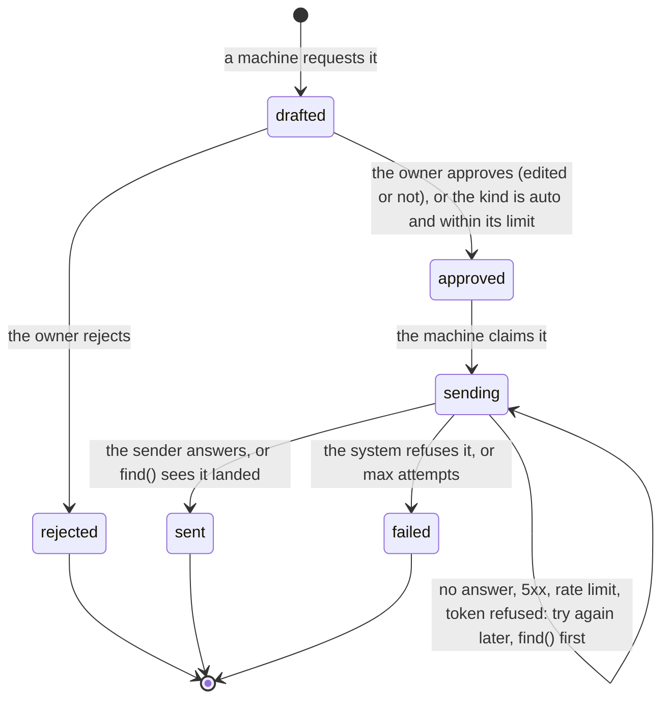

# The Outbox: specification

Status: phase 1, 2026-10-27. The design. `AGENTS.md` lists the rules that must not break.

The Outbox is an Orchestra plugin (`orchestra-outbox`, plugin `outbox`). It is the one way
anything is said or done **as the owner** in another system: Slack, GitHub, Jira, or anything a
script can reach. Machines write **drafts**; the owner **approves** (perhaps after editing) or
**rejects** each one on the Outbox page; the outbox machine **sends** what was approved, once; and
every step is an event on the bus, with metadata and never the text.

It is building block 1 of `~/orchestra_2/docs/roadmap/story-placement.md` §5, used by 19 of the 21
user stories.

Contents:

1. [Principles](#1-principles)
2. [The draft](#2-the-draft)
3. [Drafting: the API](#3-drafting-the-api)
4. [Configuration: the contract](#4-configuration-the-contract)
5. [Approval](#5-approval)
6. [Sending](#6-sending)
7. [Events](#7-events)
8. [Measurements](#8-measurements)
9. [Credentials](#9-credentials)
10. [The plugin](#10-the-plugin)
11. [Not in phase 1](#11-not-in-phase-1)

---

## 1. Principles

These are the owner's, from `docs/user-stories.md` ("What stays mine") and the owner's answers of
2026-10-27:

1. **Nothing is said or pushed as the owner without passing through the Outbox and the owner's
   approval.** Every kind waits for approval unless its configuration says `approval = "auto"`.
2. **Autonomy is configured, never built in.** A kind is loosened only by an explicit entry, which
   the owner asks the Supervisor to make. The Outbox measures what the owner would need to decide
   (unedited approvals in a row, the edit rate) but changes no setting itself.
3. **Kinds and their senders are configured, not coded.** A kind is a config entry naming its
   sender, a template and its approval. A workflow too complicated for configuration is a
   **script**, in the target repository or elsewhere, never plugin code.
4. **The Supervisor configures it; it never writes plugin code.** The contract in §4 is exact so
   that its tools can edit it, and `orchestra-outbox check` validates an edit before it is made.
5. **The bus carries no text.** Events carry ids, kinds, targets, codes and flags (Orchestra's rule
   3; the bridges' privacy rule). The text lives only in the Outbox's record.
6. **Rule 9.** The Outbox page is a human path that changes the system, which Orchestra allows
   only in a plugin. It is the owner's and nothing else's.

## 2. The draft

| Field | Meaning |
|---|---|
| `id` | `d` + 15 hex digits |
| `kind` | the configured kind's name (`review.request`) |
| `target` | where it goes: depends on the sender (§6) |
| `recipients` | who it reaches, for the limits (§5.2): ids the drafter names, else the sender's default (the channel, `owner/repo#n`, the issue key) |
| `content` | the text to send: the drafter's, rendered by the kind's template, or the owner's edit |
| `original` | the content as drafted, kept when the owner edits |
| `fields` | the drafter's fields, for the template and a payload |
| `drafter` | the machine that drafted it (its source) |
| `causationid`, `correlationid` | why: the event or ticket that caused it |
| `key` | the drafter's idempotency key: the same key again returns the same draft |
| `state` | below |
| `edited` | approved with an edit ("edited and approved") |
| `approved_by` | `owner` or `policy` |
| `held` | `rate_limit`: an `auto` draft over its limit, waiting for the owner |
| `reason`, `note` | a rejection's code (on the bus) and the owner's words (never on the bus) |
| `remote` | where it landed (`{channel, ts}`, `{repo, number, comment}`, `{issue}`, `{exit: 0}`) |
| `attempts`, `error`, `output` | sending: tries, the last error's code, a script's output |
| `created_at`, `decided_at`, `sent_at` | times |



`approved`, `rejected`, `sent` and `failed` are what the brief calls approved, rejected, sent and
failed; "edited and approved" is `approved` with `edited: true`.

The record is SQLite at `~/.orchestrator/<key>/outbox/outbox.db` (directory `0700`, file `0600`),
written by two processes (the machine and the web server), each change one transaction,
conditional on the state it leaves.

## 3. Drafting: the API

**Decision: machines draft through the outbox machine's HTTP API, not through the bus.** A draft
is text, and the bus carries no text (§1.5); an event that carried a draft would put the owner's
words in every bus backend, every reader's hands and the model's inputs. The bus still sees every
draft (§7), as metadata. The API is the outbox machine's own (not the web server's): the machine
is what `orchestra run` keeps up beside the drafters, while the web server may not run, and is
the owner's (and may be tunnelled).

`POST http://<[outbox] host:port>/drafts`, with `Authorization: Bearer <the project's token>` (the
token Orchestra gives every process it launches, `ORCHESTRA_EVENTS_TOKEN`; `orchestra events
endpoint` prints it for others):

```json
{
  "drafter": "worker/1",
  "kind": "review.request",
  "target": {"channel": "C0REVIEW"},
  "content": "optional: the text, or $content in the kind's template",
  "fields": {"link": "https://github.com/acme/widgets/pull/7", "reviewers": "@ana @bo"},
  "recipients": ["U0ANA", "U0BO"],
  "causationid": "<the event that caused it>",
  "correlationid": "<the ticket>",
  "key": "rr:acme/widgets#7"
}
```

- `201 {"ok": true, "new": true, "draft": {...}}`; `200` with `"new": false` when the `key` was
  seen from that drafter; `400 {"ok": false, "error": "<why>"}` (an unknown kind, a bad target, a
  field the template needs, a drafter named `outbox` or the owner); `401` without the token.
- `GET /drafts/<id>`: the draft as it stands, with `content`, `note`, `state`, `remote`, `error`.
- The address: `[outbox] host` and `port` (default `127.0.0.1:9467`), also written to
  `<state>/outbox/endpoint.json` while the machine runs (`port = 0` picks a free port).
- Python: `orchestra_outbox.client.OutboxClient.for_project(project, drafter=...)`.
- A drafter learns what happened by listening for the events of §7 whose `data.to` is its source.

Limits: `fields` at most 50 entries (names `[A-Za-z_][A-Za-z0-9_]*`, values strings up to 20,000
characters or numbers); `recipients` 1 to 50 ids; refs up to 200 characters; a body up to 1 MB.

## 4. Configuration: the contract

All of it is `[outbox]` in the project's `orchestra.toml` (or the private overlay, once Orchestra
has one). Orchestra ignores the section. **Unknown keys are refused**, so a typo is an error, not a
silent default. The machine re-reads the section when the file changes; a version that fails the
check is logged and the last good one stands; the web server re-reads it on every request.

### 4.1 `[outbox]`

| Key | Type | Default | Meaning |
|---|---|---|---|
| `owner` | string (a source) | `"owner"` | the source the owner's approvals and rejections publish as, e.g. `"person.danroblewis"` to match the bridges' identity map. Not `"outbox"` |
| `host` | string | `"127.0.0.1"` | where the API and `/metrics` listen. Loopback only |
| `port` | integer 0..65535 | `9467` | `0`: any free port, written to `endpoint.json`, and no instrument |

### 4.2 Systems: `[outbox.slack]`, `[outbox.github]`, `[outbox.jira]`

A system's connection, needed by its built-in senders. Present = configured.

| Key | Type | Default | Meaning |
|---|---|---|---|
| `api` | URL | Slack `https://slack.com/api`; GitHub `https://api.github.com`; Jira: none (required) | `https`; Slack only on `slack.com`; `http` only to a loopback fake |
| `token_file` | path | `~/.config/orchestra-outbox/<system>-token` | an owner-only (`0600`) file outside the repository (§9) |

A `token` key is refused.

### 4.3 Kinds: `[outbox.kinds."<name>"]`

`<name>`: lowercase words of `[a-z0-9_-]` joined by dots (`review.request`, `jira.ccb`).

| Key | Type | Default | Meaning |
|---|---|---|---|
| `sender` | string | required | `slack.message`, `slack.reply`, `github.pr_comment`, `github.label`, `jira.comment`, `jira.transition`, `jira.create`, or `script`. A built-in sender needs its system (§4.2) configured |
| `template` | string | none | renders the content from the draft's `fields`; `$name` or `${name}`, `$$` for a dollar, `$content` for the drafter's content. Without a template, the draft must carry `content` |
| `payload` | table | none | `jira.create` only, and required there: the issue's `fields`, rendered at send time from the draft's fields and `$content` (the approved text). It must have `project`, `issuetype` and `summary`. A string that is exactly one placeholder (`"$sprint"`) keeps the field's type, so a number stays a number |
| `command` | list of strings, or a string split like a shell would | none | `script` only, and required there: the command (§6.4) |
| `timeout` | duration | `"120s"` | `script` only: 1 s to 1 h |
| `target` | list of key names | `[]` | `script` only: the target keys a draft must carry |
| `approval` | `"always"` or `"auto"` | `"always"` | `"auto"`: sent without the owner while within `limit` |
| `limit` | integer ≥ 0 | none | sends of this kind per recipient in `per`, counting the owner's approvals too |
| `per` | duration ≥ 60 s | `"24h"` | the window of `limit` |

Durations are Orchestra's (`"30s"`, `"10m"`, `"24h"`).

### 4.4 Examples

```toml
[outbox]
owner = "person.danroblewis"

[outbox.slack]
[outbox.github]
[outbox.jira]
api = "https://jira.example.com"

# Story 1: "RR: link cc: @person", posted in the team's channel; the owner approves each one.
[outbox.kinds."review.request"]
sender = "slack.message"
template = "RR: $link cc: $reviewers"

# Story 1: the follow-up pacer's daily ping, sent on its own but at most once a day per reviewer.
[outbox.kinds."review.ping"]
sender = "slack.reply"
template = "Gentle ping: $link"
approval = "auto"
limit = 1
per = "24h"

# Story 15: the SAIL label, still approved each time until the owner decides otherwise.
[outbox.kinds."sail.label"]
sender = "github.label"
template = "SAIL"

[outbox.kinds."pr.reply"]
sender = "github.pr_comment"

# Story 18: the Jira close-out.
[outbox.kinds."jira.closeout"]
sender = "jira.comment"
[outbox.kinds."jira.done"]
sender = "jira.transition"
template = "Done"

# Story 4: a ticket from the team's template.
[outbox.kinds."jira.task"]
sender = "jira.create"
template = "$content"
[outbox.kinds."jira.task".payload]
project = { key = "OPS" }
issuetype = { name = "Task" }
summary = "$summary"
description = "$content"
labels = ["orchestra"]
customfield_10007 = "$sprint"          # the sprint field, a number

# Story 16: a port through the company's tool, which no built-in sender knows.
[outbox.kinds."port.request"]
sender = "script"
command = ["scripts/outbox/arc-port.sh"]
target = ["repo", "sha", "branch"]
timeout = "10m"
```

### 4.5 `orchestra-outbox check`

```
orchestra-outbox check [--repo PATH] [--file FILE | --file -] [--json]
```

Exit 0 valid, 1 not, 2 unreadable. `--json` answers `{"ok", "errors": [...], "warnings": [...],
"kinds": {name: {sender, approval, limit, per}}}`. Every error is a sentence naming the key, e.g.
`[outbox.kinds."a"] uses the sender slack.message, but [outbox.slack] is not configured`. All
errors are reported at once. Warnings (a script that is not a file or not executable, a token file
readable by others) do not fail it. The Python form is `orchestra_outbox.check.check(raw,
repo_root)` and `orchestra_outbox.config.problems(raw)`.

## 5. Approval

### 5.1 The owner

The Outbox page (`/outbox`) lists the drafts waiting, each with its kind, sender, target, drafter,
cause, age and text in an editable box. **Approve** sends it as it is; after an edit, **Approve the
edit** sends the edit. **Reject** takes a reason code (`content`, `target`, `not_needed`,
`duplicate`, `timing`, `other`), which reaches the drafter on the bus, and an optional note, which
the drafter reads from the API. The page also shows the recent decisions (with the original text
of an edited one and a script's output), the kinds with their approval, limit and **unedited
approvals in a row**, and the audit log.

The page's API: `GET /api/plugins/outbox/state`; `POST /api/plugins/outbox/drafts/<id>/approve`
`{"content"?}`; `POST .../reject` `{"reason", "note"?}`. The writes need `Content-Type:
application/json`; `409` when the draft was decided already.

**Who can reach it.** The page, the API and the static files are behind Orchestra's web login
(Orchestra's SPEC §10.2, PLUGINS.md §4.4.1): a request reaches `web.py` only with the browser's
session cookie or `Authorization: Bearer <the web token>` (`orchestra web token`; not the events
token the drafters use, §3). A `POST` carried by the cookie must also name Orchestra's own origin
(`Origin` or `Referer`, and no cross-site `Sec-Fetch-Site`), or Orchestra answers `403` before the
outbox sees it; a `fetch` from the page sends it by itself. The outbox's own JSON check stays: it
adds to Orchestra's and replaces nothing. `tests/unit/test_flow.py` approves and rejects as a
logged-in browser does.

The web server writes the decision to the record and nothing else: it holds no token and sends
nothing. The outbox machine publishes the decision and sends.

### 5.2 A kind set to `auto`

A draft of an `auto` kind is approved by the policy (`approved_by: "policy"`, published from the
source `outbox`) when it is drafted, unless one of its recipients already has `limit` drafts of
that kind approved (by anyone) in the last `per`. Then it is **held**: it waits for the owner like
any other draft, marked `held: rate_limit`, and `outbox.draft.held` says so. The owner may still
approve it: the limit binds the policy, not the owner. An `auto` send is audited like any other.

## 6. Sending

The outbox machine tries every approved draft within half a second. It claims it (`sending`),
calls the sender, and records `sent`, `failed`, or "not known" (§2's diagram). **Every try after
the first asks the sender to find the draft before sending again**, by a mark it carries where it
landed. A restart resumes the same way: a draft left `sending` is found or sent; a draft left
`approved` is sent; a draft left `drafted` waits. A send is never repeated blindly, except where
noted below. The pause between tries doubles from 5 s to 5 min (longer if the system asks), and
after 8 tries the draft is `failed`.

### 6.1 Slack (`slack.message`, `slack.reply`)

`chat.postMessage` with a user token (`xoxp-`, `chat:write`), so it posts as the owner. Target:
`{"channel": "C…"}`, plus `"thread_ts"` for a reply. Each message carries Slack message metadata
`{"event_type": "orchestra_outbox_draft", "event_payload": {"draft": <id>}}`, invisible in the
channel; `find` reads `conversations.history` (or `.replies`) with `include_all_metadata` (needs
the `*:history` scopes). `ok: false` with an auth error or `ratelimited` is tried again; any other
error (`channel_not_found`, `msg_too_long`, ...) fails the draft.

### 6.2 GitHub (`github.pr_comment`, `github.label`)

`POST /repos/{o}/{r}/issues/{n}/comments`, with `<!-- orchestra-outbox:<id> -->` appended (an HTML
comment: not rendered; the page says so), which `find` looks for. `POST .../labels` with the one
label (the content: one name); adding a label twice is a no-op, so a label is simply sent again.
Target: `{"repo": "owner/name", "number": n}`. A 401 or a rate limit is tried again; another 4xx
fails the draft.

### 6.3 Jira Data Center (`jira.comment`, `jira.transition`, `jira.create`)

REST API v2 (`<api>/rest/api/2`), a personal access token as `Bearer`.

- `jira.comment`: target `{"issue": "OPS-12"}`; `POST /issue/{key}/comment` with the entity
  property `orchestra-outbox` `{"draft": <id>}`; `find` reads the comments with
  `expand=properties`.
- `jira.transition`: target `{"issue"}`; the content is the transition's name or id (a template
  fixes it: `template = "Done"`). Resolved by `GET /issue/{key}/transitions`, made by `POST`.
  `find` counts it made when the issue no longer offers it: an inference, recorded as
  `"verified": "no_longer_offered"`.
- `jira.create`: target `{}` or `{"project": "OPS"}` (overrides the payload's project); `POST
  /issue` with the kind's payload rendered and the property `orchestra-outbox`; `find` searches
  `reporter = currentUser() AND created >= -Nm` and reads each issue's property.

A 401 is tried again; another 4xx fails the draft.

### 6.4 Scripts (`script`)

For anything else (`arc feature`, a company tool, a chain of calls). The kind's `command` runs:

- in the repository root, with the outbox's environment plus `OUTBOX_DRAFT_ID`, `OUTBOX_KIND` and
  `OUTBOX_ATTEMPT` (1 on the first try); a first argument with a `/` is relative to the repository
  root, anything else is found on `PATH`;
- with the approved draft as one JSON object on stdin: `id`, `kind`, `target`, `recipients`,
  `content`, `fields`, `drafter`, `causationid`, `correlationid`, `edited`, `approved_by`,
  `attempt`;
- exit 0: `sent` (`remote: {"exit": 0}`). Exit 75 (`EX_TEMPFAIL`) or no exit within `timeout`
  (then its process group is killed): tried again. Any other exit: `failed`, with the code
  (`script:exit_3`);
- its output (stdout and stderr, the last 4 KB) is kept in the record and shown on the page; only
  the exit status reaches the bus.

A script cannot be asked whether an earlier run landed. **A script must be idempotent on
`OUTBOX_DRAFT_ID`.**

### 6.5 What no sender does

There is no sender that approves or merges a pull request, opens one, or pushes. A script could;
whether such a kind may exist, and under which approval, is the owner's configuration (§11).

## 7. Events

Every change is an audit row written with it, and the machine publishes the rows not yet on the
bus, in order, each from the source of whoever acted, at the time they acted, with the id
`outbox:<draft>:<n>` (so a repeat after a crash has the same id). `subject` is the draft's id.

| Type | Source | `data` |
|---|---|---|
| `outbox.draft.created` | the drafter | `draft`, `kind`, `sender`, `target` (not for a script), `recipients`, `approval`, `chars` |
| `outbox.draft.held` | `outbox` | `draft`, `kind`, `to`, `reason` (`rate_limit`) |
| `outbox.draft.approved` | the owner, or `outbox` for the policy | `draft`, `kind`, `to`, `by` (`owner`/`policy`), `edited` |
| `outbox.draft.rejected` | the owner | `draft`, `kind`, `to`, `reason` (a code), `note` (whether there is one) |
| `outbox.sent` | `outbox` | `draft`, `kind`, `to`, `remote`, `attempts` |
| `outbox.send_failed` | `outbox` | `draft`, `kind`, `to`, `error` (a code), `attempts` |
| `orchestra.machine.started` | `outbox` | `package: "outbox"`, `mode: "continuous"`, `kind: "program"`, `listens_for: []`, `log` |

`to` is the drafter: the event is addressed to it. `outbox.draft.created` carries the drafter's
`causationid` and `correlationid`; each later event's `causationid` is the event it follows, and
`correlationid` is kept. **No event carries content**: not the text, an edit, a template's output,
a label's name, a note or a script's output. Targets are ids (a conversation id, `owner/repo` and
a number, an issue key).

## 8. Measurements

Served on the machine's `/metrics` (no token: no content) and stored by the instrument
`outbox.outbox` the plugin declares (every 30 s), read from the record each time, so a restart
neither resets nor double-counts:

| Series | Kind | Labels |
|---|---|---|
| `outbox_drafts_waiting` | gauge | `kind` |
| `outbox_oldest_draft_waiting_seconds` | gauge | none |
| `outbox_drafts_sending` | gauge | `kind` |
| `outbox_drafts_created_total` | counter | `kind` |
| `outbox_drafts_approved_total` | counter | `kind`, `by`, `edited` |
| `outbox_drafts_rejected_total` | counter | `kind` |
| `outbox_drafts_sent_total` | counter | `kind` |
| `outbox_drafts_failed_total` | counter | `kind` |

## 9. Credentials

Each system's token, in order: `<SYSTEM>_OUTBOX_TOKEN` (`SLACK_`, `GITHUB_`, `JIRA_`); the file
`<SYSTEM>_OUTBOX_TOKEN_FILE` names; `[outbox.<system>] token_file`;
`~/.config/orchestra-outbox/<system>-token`; for GitHub only, finally `gh auth token --hostname
<host>`. A file must be outside the repository, `chmod 600` and not empty. A token is read when a
send first needs it (so one placed later is picked up), kept in memory by its sender only, sent
only to the configured API's origin (redirects elsewhere refused), never logged, published or
written. The environment variables are for tests: `orchestra run` passes its environment to every
process it starts.

Scripts bring their own credentials.

## 10. The plugin

| Field | What |
|---|---|
| `pages` | `/outbox` ("Outbox") |
| `static` | `outbox.html`, `outbox.js`, `outbox.css` (page-only; nothing on every page) |
| `router` | `/api/plugins/outbox/state`, `/drafts/<id>/approve`, `/drafts/<id>/reject` |
| `machines` | `outbox` (program, continuous), when `[outbox]` exists |
| `processes` | `outbox.sender`: `python -m orchestra_outbox run`, when `[outbox]` exists |
| `collectors` | `outbox` scraping `http://<host>:<port>/metrics` every 30 s, when `[outbox]` exists and `port` is not 0 |

## 11. Not in phase 1

- **Earning autonomy automatically.** The page shows unedited approvals in a row and `/metrics`
  the edit rate; the owner decides, through the Supervisor (§1.2).
- **Outbox kinds for the Supervisor's tools.** The contract (§4) and `check` are ready; the tools
  are a later change to `orchestra-agents`.
- **Pushes, opening PRs, approving PRs.** No built-in sender; a script could (§6.5).
- **Docs (`doc.create`), Slack edits and deletes, GitHub review comments.**
- **Opt-in contract tests against the real APIs** (the bridges have them). The fakes follow the
  documented shapes; Slack's message metadata on a user token and Jira's comment properties on
  create are the two shapes most worth checking against a real instance.
- **Retrying a failed draft from the page.** A failed draft is final; the drafter is told and may
  draft again.
